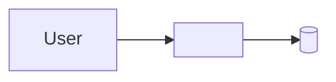

# Architecture

<1-2 sentences: what the system does at the highest level.>

## Overview

## Components

| Component | Responsibility | Lives in |
|---|---|---|
| <name> | <one line> | `<path>` |

## Data flow

1. <step>
2. <step>

## Key decisions

See [docs/adr/](adr/). The most important: <link to ADR>.

## Constraints

- <performance, hardware, platform, or budget limit that shapes the design>
