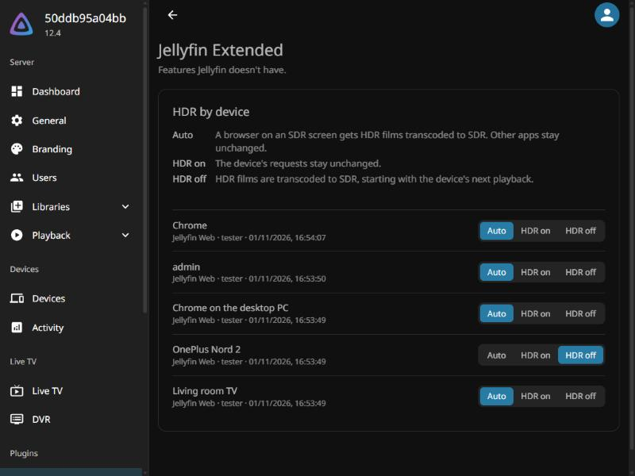

<p align="center">
  
</p>

# Jellyfin Extended

A Jellyfin 12 plugin that adds features Jellyfin doesn't have, built for the owner's server and shared as-is with best-effort support.



## Features

- Choose Auto, HDR on or HDR off for each device, so a device with wrong HDR contrast can use Jellyfin's transcoding and tone mapping instead.
- On Auto, the default, get HDR films transcoded in a browser on an SDR screen. Native apps stay unchanged on Auto, so set those by hand.
- Set any device from the admin page, under Dashboard > Plugins > Jellyfin Extended.
- Set your own browser from its playback settings page, which also says what Auto currently detects (v1.2 and later).

## Usage

Requires Jellyfin 12.x, with tone mapping turned on under Dashboard > Playback > Transcoding.

1. Under Dashboard > Plugins > Repositories, add this repository URL:
   `https://brydlstepan.github.io/jellyfin-extended/manifest.json`
2. Under Dashboard > Plugins > Catalog, install Jellyfin Extended.
3. Restart Jellyfin. The plugin shows as Active under Dashboard > Plugins.

For example, if a phone shows HDR films with too much contrast, find it on the admin page and set it to HDR off. Its next playback of an HDR film is transcoded to SDR.

## Development

This needs the .NET 10 SDK. Run the tests, then build the plugin:

```bash
dotnet test tests/Jellyfin.Plugin.Extended.Tests
dotnet build src/Jellyfin.Plugin.Extended -c Release -o artifacts/plugin
```

After building, check it against a throwaway Jellyfin 12 server with generated clips. This needs Docker and PowerShell 7:

```bash
pwsh tests/real-server/run.ps1
```

To check installing through a plugin repository, on another throwaway server:

```bash
pwsh tests/real-server/repository.ps1
```

To install a local build by hand:

1. Stop Jellyfin.
2. Copy `Jellyfin.Plugin.Extended.dll` and `meta.json` from `artifacts/plugin` to `<config>/plugins/JellyfinExtended_<version>/`.
3. Start Jellyfin. The plugin shows as Active under Dashboard > Plugins.

To release, set the new version in `meta.json` and the csproj, such as `1.2.0.0`, merge that to `main`, then push the matching short tag, such as `v1.2`. The Release workflow runs the tests, creates the GitHub release with the plugin zip, and adds the version to `manifest.json` on the `manifest` branch, which GitHub Pages serves.

To contribute, open an issue first. Support is best-effort, so a reply may take a while.

## Docs

- [Architecture](docs/ARCHITECTURE.md)
