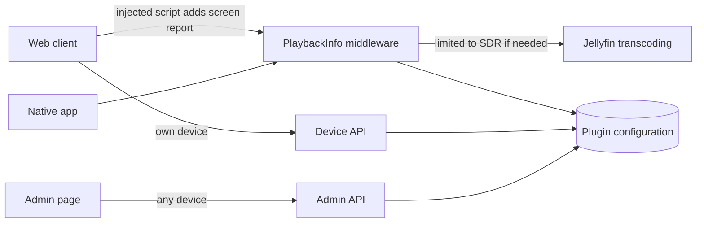

# Architecture

The plugin changes what a device tells Jellyfin it can play. When a device should get SDR, the plugin limits the video range in its playback request, and Jellyfin's own transcoding and tone mapping do the rest.

## Overview

## Components

| Component | Responsibility | Lives in |
|---|---|---|
| Plugin and configuration | Stores each device's mode, by device ID. Auto is the default and isn't stored | `src/Jellyfin.Plugin.Extended/Plugin.cs`, `PluginConfiguration.cs` |
| PlaybackInfo middleware | Rewrites the playback request of a device that should get SDR | `src/Jellyfin.Plugin.Extended/PlaybackInfoMiddleware.cs` |
| SDR profile | Limits the device profile's video range to SDR. It doesn't touch audio | `src/Jellyfin.Plugin.Extended/SdrProfile.cs` |
| Screen report | Decides whether a mode and a screen report mean SDR. Off always does, and Auto does only for an `sdr` report | `src/Jellyfin.Plugin.Extended/ScreenReport.cs` |
| Web client page middleware | Adds the script to the web client's page | `src/Jellyfin.Plugin.Extended/WebClientPageMiddleware.cs` |
| Web client script | Sends the `X-Extended-Screen` header and adds the toggle to the playback settings page | `src/Jellyfin.Plugin.Extended/screen-report.js` |
| Device API | Reads and sets the calling device's mode, using the device its token was issued to | `src/Jellyfin.Plugin.Extended/HdrOverrideController.cs` |
| Admin API and page | Lists every device and sets any device's mode, for admins only | `src/Jellyfin.Plugin.Extended/AdminDevicesController.cs`, `Web/devices.html` |
| Release | Tests, packages and publishes a version when a `v*` tag is pushed | `.github/workflows/release.yml`, `.github/scripts/release.ps1` |

## Data flow

1. The web client's page loads with the script in it. The script reports the screen as `sdr`, `hdr` or `unknown` on each playback request. Native apps send no report.
2. A device asks Jellyfin for playback info.
3. The middleware looks up the device's mode. If the mode and report mean SDR, it limits the request's video range to SDR.
4. Jellyfin sees that the HDR video isn't supported, so it transcodes and tone maps it. Anything unexpected in a request passes through unchanged.

## Key decisions

- **One plugin:** later features join this plugin, each as its own card on the admin page.
- **Auto in native apps:** it leaves them unchanged, because they don't report their screen. Set those devices by hand.
- **Settings follow the device:** they're saved on the server by device ID, so they survive a logout. New browser data means a new device ID, which starts on Auto.
- **Releases:** a version tag runs GitHub Actions. The `manifest` branch holds the plugin repository's manifest, which GitHub Pages serves.
- **Tests:** unit tests run in CI, and the real-server test is a local script because it needs Docker and a Jellyfin server.

## Constraints

- Jellyfin 12.x only.
- Tone mapping must be turned on in the server's transcoding settings.
- The plugin doesn't change media files or fix a browser's own HDR-to-SDR conversion.
- No film clips in the repo. Test clips are generated.
